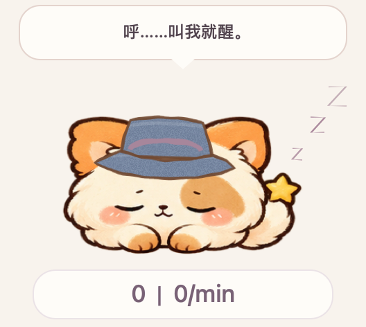

# 敲敲 · QiaoQiao

一只陪你敲键盘、换装、犯困和休息的小星狸。桌面只保留头像和 `数字｜数字/min`，其他设置收在右键菜单里。



## 下载

**[前往 Releases 下载 Mac / Windows 版本](https://github.com/Eiternal/qiaoqiao/releases)**

| 文件 | 系统 | 使用方式 |
| --- | --- | --- |
| `QiaoQiao-macOS-0.9.4.zip` | macOS 13+，Apple Silicon / Intel | 解压，把「敲敲.app」拖到应用程序后打开 |
| `QiaoQiao-Windows-x64-0.9.4.zip` | Windows 10/11 x64 | 完整解压文件夹，双击 `QiaoQiao.exe`；已包含 .NET 运行时 |

两个下载包都是未进行商业代码签名的个人分享版。Mac 尚未做 Apple 公证，首次打开可能需要在系统设置 → 隐私与安全性中选择允许打开。Windows 可能显示发行者未知；请核对文件来自本仓库 Releases。请勿仅复制 Windows 的 exe，运行时和素材都在旁边的文件夹中。

Windows 是首次移植预览版。构建、核心规则、原生窗口启动、Raw Input 注册和渲染由 CI 检查；尚未经过实体 Windows 电脑上的完整人工体验验收。Mac 已在原生环境验证。具体证据见 [验证说明](docs/VALIDATION.md)。

## 它会做什么

- 按下一次键盘或鼠标按钮，数字加一；`/min` 是最近 60 秒的同类操作数，随时间自动变化。
- Shift、Ctrl、Command / Windows 等修饰键也计数；按住自动重复和松开不重复计数。中文输入按实际按键计算，粘贴文字不会按字数计数。
- 鼠标移动、拖动和滚动只用于判断活跃，不增加数字。
- 敲得快、连续删除、摸摸、拖着走、缩放、换装都有动作或短暂气泡反馈。
- 短暂犯困后进入安稳睡眠，闭眼轻轻呼吸，旁边飘出 ZZZ；有输入立即醒来。
- 每累计 100 次输入解锁一套装扮，共 100 套；可自动换装，也可打开衣柜手动选择。
- 大小可调为推荐值的 50%–180%，并按所在屏幕工作区和系统缩放调整。
- 连续工作达到设定时间提醒休息；支持 20 / 30 / 45 / 60 分钟或关闭。
- 输入事项和时间，到点弹出提醒，可完成、十分钟后再提醒或知道了。

定时提醒需要敲敲保持运行。退出、关机期间不会调用系统闹钟；错过的未处理事项在下次启动后提醒。

## 第一次打开

**Mac：**将应用放进应用程序文件夹，按程序提示授予「输入监控」权限。更新后若权限失效，请在系统设置 → 隐私与安全性 → 输入监控里移除旧条目，再添加应用程序里的敲敲并重新打开。未授权时数字旁会显示状态点，可点击连接。

**Windows：**正常用户权限运行即可，右键头像或托盘图标打开设置；隐藏后可从托盘找回。不需要管理员权限。部分键盘的 Fn 键由硬件自行处理，Windows 没有发出输入事件时无法单独计数。

默认 60 秒没有输入会睡觉，休息提醒为 45 分钟。按下数字区域可恢复暂停的计数。设置窗口可以显示文字，日常桌宠不保留额外说明。

## 隐私与数据

敲敲离线运行，不上传输入记录。仅处理按下、松开及活跃事件；不读取输入的文字、剪贴板、正在使用的应用名称，也不保存鼠标轨迹。你主动填写的提醒标题会保存在本机。

- Mac：`UserDefaults`，域名 `local.qiaoqiao.desktop`。
- Windows：`%LOCALAPPDATA%\QiaoQiao\state.json`，上一次保存备份为 `state.json.bak`。

两个平台的存档目前独立，没有云同步。发布包不包含开发者自己的计数、权限诊断或提醒事项。

## 从源码构建

Mac 需要 Xcode Command Line Tools：

```sh
macos/build.command "$PWD/dist/敲敲.app"
# 生成 Apple Silicon + Intel 通用包并验证
bash scripts/package-macos.sh
```

Windows 需要 .NET 10 SDK，使用 PowerShell：

```powershell
./scripts/package-windows.ps1
```

跨平台核心测试：

```sh
dotnet run --project windows/QiaoQiao.Tests -c Release -- "$PWD"
```

Windows 发布脚本会执行规则/素材测试、生成自带运行时的 x64 程序、在 Windows 上启动并渲染预览，最后输出 ZIP 和 SHA256。GitHub Actions 同时构建两端。未在 CI 中进行真实硬件按键、混合 DPI 多屏拖动或长时间驻留的人工验收。

## 源码与许可

`macos/` 是原生 Mac 工程，`windows/` 是原生 Windows 工程，`assets/` 是共用装扮与动画挂点数据。角色仍采用当前图片逐帧动画，没有更换美术路线。

MIT 许可。角色和参考技术的来源见 [NOTICE.md](NOTICE.md)，感谢 [mg-styles-15](https://github.com/Vincentwei1021/mg-styles-15) 的逐帧节奏和线条示例。
